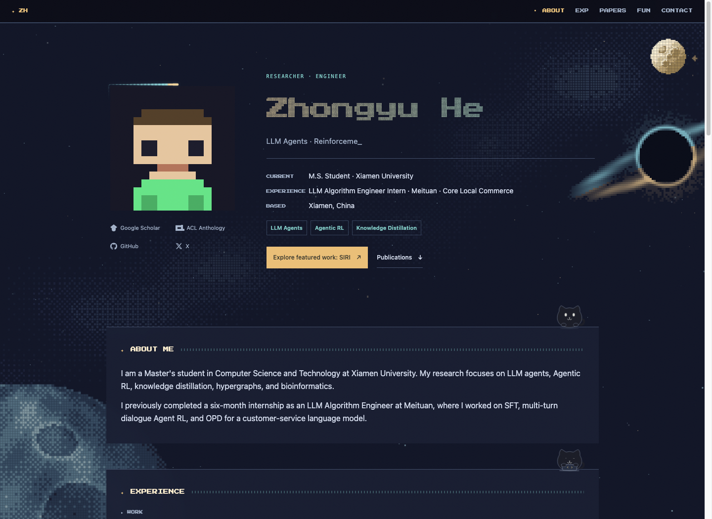

# Pixel Observatory · 像素星空个人主页

纯静态的个人学术主页模板，使用 HTML、CSS 和原生 JavaScript，无框架、无构建步骤。

[在线演示](https://hezy618.github.io/) · [开源模板分支](https://github.com/Hezy618/Hezy618.github.io/tree/master)

> `main` 是作者实际使用的个人站点；**`master` 是可复用模板**，使用占位头像，不包含 SIRI 论文子站。在线演示使用作者的真实照片，默认白天；模板默认夜间。



## 当前设计

- **昼夜星空**：缓慢自转的抖色像素星球、银河与倾斜吸积盘黑洞；白天使用暖白、青蓝和柔金，夜间使用深蓝星空。点击太阳／月亮切换。主题不写入 localStorage，刷新恢复默认状态。
- **字符过渡**：ASCII 字符波前与像素边界同步揭示新主题；等待浏览器快照释放后清理，背景暂停并恢复，减少结束时的跳变。不支持 View Transition 时采用直接换肤配合字符动画的回退。
- **液态光标**：64px 局部液态放大镜，折射底下的文字、照片、SVG 和动态画布。保留原生点击目标，触屏及减少动态效果模式关闭跟随。液态折射依赖浏览器对 SVG backdrop-filter 的支持，已在桌面 Chrome 验证；其他浏览器效果可能不同。
- **个人信息区**：方形照片、透明翻面背面、头粗尾细的流动光边、点阵姓名和两列个人链接。支持 GitHub、Google Scholar、ACL Anthology 和 X 图标。
- **纯猫小伙伴**：短圆耳、昼浅夜深的毛色，眼睛用平滑弹簧运动跟随鼠标；经历区敲代码、论文区读书、奖项区庆祝、兴趣区戴头带跑步。支持点击和键盘互动，屏外暂停待机动画。
- **论文展示**：作者姓名自动加粗、共同一作标记、Accepted／Under Review 状态、评级标签、关键词，以及带图标的 PDF／ACL／Homepage 入口。评级与资源按钮适配昼夜配色。
- **可访问性**：键盘操作、焦点样式、响应式布局，以及 `prefers-reduced-motion` 静态模式。

旧版马里奥背景、圆形塔罗头像和旧像素猫已不作为当前模板的展示设计。

## 快速开始

```bash
git clone --branch master --single-branch https://github.com/Hezy618/Hezy618.github.io.git my-homepage
cd my-homepage
python3 -m http.server 8000
```

访问 `http://localhost:8000`。建议使用 HTTP 本地预览，避免 `file://` 的浏览器安全限制。

## 修改个人内容

编辑 `data.js`。当前内容以作者经历作为公开示例，使用前请替换为自己的资料。

| 内容 | 字段 |
|---|---|
| 姓名、简介、照片 | `name`、`tagline`、`heroSummary`、`photo` |
| 学位、大学、城市、联系邮箱 | `degree`、`university`、`location`、`email` |
| 研究方向 | `research`（首屏显示前三项） |
| 个人链接 | `links`（增删后自动排列） |
| 主要项目入口 | `featuredWork`：`{ label, url }`；设为 `null` 隐藏 |
| 照片翻面文字 | `tarot.backQuote`、`tarot.backQuoteDay` |
| 简介、经历、教育、奖项、爱好 | `bio`、`experience`、`education`、`awards`、`hobbies` |
| 论文与评级链接 | `publications`、`levelLinks` |

把照片放到 `pic/` 后，将 `photo` 改为自己的路径，例如 `pic/avatar.jpg`。模板默认使用 `assets/photo.svg` 占位头像。首屏的经历摘要取自 `experience` 第一项，联系入口读取 `email`。

```js
{
  title: "Your Paper Title",
  authors: ["Your Name*", "Co Author*"],
  venue: "Conference or Journal",
  year: 2026,
  status: "Accepted", // 在审可填 Under Review
  level: "CCF-A",
  extraLevels: ["CORE A*"],
  keywords: ["LLM Agents", "Reinforcement Learning"],
  links: {
    PDF: "https://example.com/paper.pdf",
    Homepage: "https://example.com/project/"
  }
}
```

`experience`、`publications`、`awards` 为空数组时，对应区块隐藏。若想默认白天，将 `index.html` 的 `<html lang="en">` 改为 `<html lang="en" class="day">`。

文字内容主要由 `data.js` 控制；修改页面布局、动效或导航区块仍需编辑相应 HTML／CSS／JS。模板保留外部字体链接，离线或字体加载失败时使用系统回退字体。

## 部署 GitHub Pages

1. 在自己的 GitHub 账号下创建空仓库。个人根站点使用 `<用户名>.github.io`；普通项目页也可以使用其他仓库名。
2. 修改个人资料后，将本地模板推送到自己的仓库：

```bash
git remote set-url origin https://github.com/<用户名>/<仓库名>.git
git branch -M main
git add .
git commit -m "Customize my homepage"
git push -u origin main
```

3. 在目标仓库 **Settings → Pages → Build and deployment** 中选择从分支部署，选 `main` 和 `/ (root)`，保存并等待部署成功。
4. 个人根站点地址为 `https://<用户名>.github.io/`，普通项目页地址为 `https://<用户名>.github.io/<仓库名>/`。

使用 Fork 时也要确认当前分支：本仓库默认 `main` 是个人站点，模板位于 `master`。不要依赖未指定分支的 clone 命令获取模板。

## 文件结构

```text
index.html           页面结构与默认主题
style.css            昼夜样式、光边与待机动画
data.js              个人内容与主要项目入口
script.js            内容渲染、导航、照片交互
cosmic.js            像素星空、星球与黑洞
signal.js            点阵姓名
cursor.js            全页液态光标
theme-transition.js  字符波前和换肤时序
companions.js        小猫造型、视线与互动
assets/              占位头像、ACL 图标、预览等素材
pic/                 个人照片目录（默认留空）
```

## 检查与贡献

无需安装 Node 来运行页面；修改 JavaScript 时，如已安装 Node，可执行语法检查：

```bash
node --check script.js
node --check cosmic.js
node --check signal.js
node --check cursor.js
node --check theme-transition.js
node --check companions.js
node --check data.js
git diff --check
```

也请在浏览器中检查昼夜切换、鼠标交互、手机布局和减少动态效果模式。欢迎通过 Issues 反馈问题、提交 PR 改进模板，也欢迎 Star 支持。
